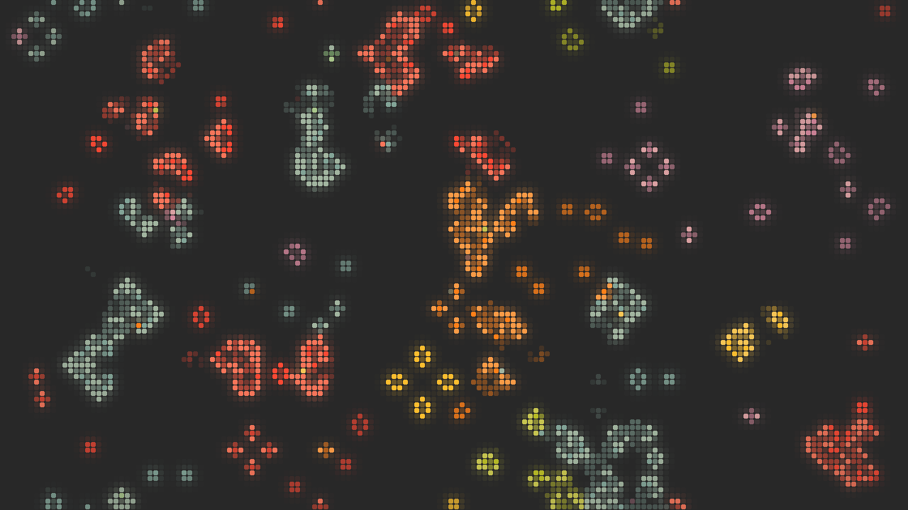

# Conway's Game Of Life Wallpaper

## Installation

### Automatic user install (recommended)

Requirements: a Rust toolchain (`cargo`) and a Wayland compositor that supports `zwlr_layer_shell_v1`.
From the project directory, run:

```sh
./install.sh
```

The script builds the optimized binary and installs it to `~/.local/bin`, the man page to `~/.local/share/man/man1`, and example TOML files to `~/.local/share/life-wallpaper/config_example`. It creates `~/.config/life-wallpaper/config.toml` from the default template only if that file does not already exist, so existing settings are preserved.

If `life-wallpaper` is not found after installation, ensure `~/.local/bin` is on your `PATH`:

```sh
export PATH="$HOME/.local/bin:$PATH"
```

To use the installed manual page:

```sh
man life-wallpaper
```

The script supports these environment overrides: `PREFIX` (default `~/.local`), `BIN_DIR`, `DATA_DIR`, `MAN_DIR`, `CONFIG_DIR`, and `CARGO`.

### Manual install

```sh
cargo build --release
mkdir -p "$HOME/.local/bin" "$HOME/.local/share/man/man1" "$HOME/.config/life-wallpaper"
install -m 755 target/release/life-wallpaper "$HOME/.local/bin/life-wallpaper"
install -m 644 man/life-wallpaper.1 "$HOME/.local/share/man/man1/life-wallpaper.1"
install -m 644 config_example/config.default.toml "$HOME/.config/life-wallpaper/config.toml" # only if you don't already have one
```

If you already have a config file, skip the last command to avoid overwriting your settings. To run without installing, use `cargo run --release -- --preset ambient`.

## Usage

```bash
cargo build --release
cargo run
cargo test
```

## Presets

Select a built-in preset from the command line:

```bash
life-wallpaper --preset default
life-wallpaper --preset ambient
life-wallpaper --preset matrix-rain
life-wallpaper --preset neon-brain
life-wallpaper --preset minimal
```

Preset values are loaded first, then an existing config file can override them, and command-line flags take final precedence. If the config file is missing, it is created from the default template, while the selected preset remains active for that first run. Individual flags can override preset values, for example `life-wallpaper --preset neon-brain --fps 6`.

The manual page is in `man/life-wallpaper.1`. View it with `man ./man/life-wallpaper.1`.

## Staleness and resets

The board is never wiped on a timer. When it goes calm (`stagnation_secs`, default 60, with moving or chaotic cells below `calm_pct` of the grid, or the whole board repeating), new life is added on top of what is already there: soup patches in the emptiest areas plus gliders. When still lifes and oscillators pile up and cover `clutter_pct` of the grid (default 8, `0` = never), about half of them are pruned, whole shapes at a time, fading out over a few generations. The board is never wiped. New soup patches are also dripped in over a few generations instead of appearing at once. `soft_reset_secs` still exists as an optional timed full reset and defaults to `0` (off).

If your existing `~/.config/life-wallpaper/config.toml` was created from an older template, it still contains `soft_reset_secs = 300`. Set it to `0` (or delete the line) to stop the timed resets.

## Keeping the board lively

Nothing here wipes the board. Everything either adds life, thins out frozen shapes, or changes the pace.

- **Local calm (`local_calm_secs`, `tile_size`):** the board is cut into tiles. A tile with nothing moving in it for `local_calm_secs` gets a soup patch (sometimes symmetric), a glider aimed through it, or a methuselah (R-pentomino / acorn). One tile at a time, and not while more than 30% of the board is alive.
- **Decay (`decay_after`, `decay_chance`):** cells that have been stuck in a still life or oscillator for `decay_after` generations (counted once the 64-generation history shows it) die with `decay_chance` per generation. Gliders and chaos are never touched.
- **Cosmic rays (`noise_per_sec`):** random single-cell disturbances knock oscillators out of phase.
- **Rule shifts (`rule_shift_secs`, `rule_shift_gens`, `rule_shift_mode`, `rule_shift_stagger`):** every so often the rule becomes `B34/S23`, `B3/S234` or `B3/S2345` for a few generations, then returns. Only on Life / HighLife boards. By default (`rule_shift_mode = "ripple"`) it travels: tiles switch over ring by ring from a random tile, each holding the new rule for `rule_shift_gens` generations, `rule_shift_stagger` generations apart, so it moves across the board as a wave. `"global"` flips the whole board at once (a pulse; the overlay then shows the temporary rule). A board with a single tile falls back to global. Longer holds flood the board, so keep `rule_shift_gens` small.
- **Fast-forward (`fastforward`, `fastforward_speed`):** while the whole board is calm it runs several generations per tick.
- **Colonies (`colonies`, `colony_mutation`, `colony_colors`):** every cell has a colony; a newborn takes the majority colour of its parents, now and then mutating. Each injection brings a fresh colour. Needs `color = "age"`; shading by age still applies.
- **Traffic and guns (`traffic`, `gun_secs`):** convoys of two to four LWSS / MWSS / HWSS enter from one edge; Gosper guns are removed after `gun_secs`.
- **Symmetry (`symmetry_chance`):** injected soups are sometimes mirrored or rotated.
- **Hyprland (`hypr_events`, `hypr_locate`):** listens on Hyprland's event socket. A workspace switch sends gliders across. With `hypr_locate` (default) the wallpaper also asks Hyprland's command socket where windows are: a closed window leaves a symmetric bloom where it was, and a new window gets a ring of soup around its edge (the window itself covers the wallpaper). Only the output the window is on reacts. Geometry is cached from `j/clients` and refreshed shortly after events that can move windows, so a floating window dragged and closed without ever being focused may bloom at its old spot; anything Hyprland cannot place falls back to a random empty spot. With `hypr_locate = false` every event uses a random spot. Does nothing outside Hyprland.
- **Clock stamp (`clock_stamp_secs`):** every ~`clock_stamp_secs` seconds (default 600, 0 = off) a stamp spells the local time as `HH:MM` in the same 5x7 font as the text stamps, and the rules then eat it like any other stamp. Needs `stamps = true`.
- **Audio (`audio`, `audio_sensitivity`, `audio_command`):** off by default. When on, a helper process records the monitor of the default output (whatever is playing): `pw-cat`, or `parec` / `pacat` if it is not installed (a custom `audio_command` is used on its own). If the helper dies (PipeWire restart, device change) it is restarted with a growing delay (`audio_restart_backoff`, `audio_restart_max_secs`), and it is stopped while every output is hidden or nothing would use it. What the audio does is chosen separately: `audio_gliders` (a beat sends a glider, as before) and `audio_react` (the board lights up, no cells added). The light is a smoothed level with a fast attack and slow release (`audio_attack_ms`, `audio_release_ms`, frame-rate independent) plus a short flash on each beat (`audio_flash`, `audio_flash_ms`); it brightens live cells (`audio_brighten`), grows the halo (`audio_glow`) and tints the background (`audio_bg`), scaled by `audio_gain` and gated by `audio_floor`. The signal is split into bass, mid and treble with two single-pole filters (no FFT): bass drives the glow and flash, mid the brightness, treble the background. `audio_band_*_sensitivity` tune each band's beat detector (default: follow `audio_sensitivity`), and `audio_band_bass_gliders`, `audio_band_mid_sparks`, `audio_band_treble_noise` route a band's beats to gliders, sparks or cosmic rays. Night, battery and idle dimming are applied last, so the light never defeats them. `--verbose` prints peak/avg/threshold per band once a second, which is what you tune against.
- **Control socket (`ipc`, `ipc_path`) and `life-wallpaper-ctl`:** off by default. One command per line, one reply line: `inject NAME [--at X Y] [--edge E]`, `inject text "WORDS"`, `reseed [--rule R] [--density D]`, `stats`, `set KEY VALUE`, `pause`, `resume`, `quit`, `load scene NAME`, `save scene NAME`. The socket is `$XDG_RUNTIME_DIR/life-wallpaper-<output|all>.sock` (mode 0600). `set` changes any key except the ones read at start-up and lasts until the next config reload. Injections share one cooldown with beats and Hyprland events, so a flood is refused with `err busy`. Named patterns: `glider lwss mwss hwss r-pentomino acorn diehard pulsar gun tux arch blinker toad beacon pentadecathlon engine infinite-line queen-bee-shuttle crown lantern petals cross`, plus `soup`, `convoy`, `methuselah`, `clock`, `text=WORDS`.
- **Battery (`power`, `battery_threshold`, `battery_dim`, `battery_fps_scale`, `battery_disable`):** on battery at or below the threshold the palette dims (stacking with `night_dim`), the rate is scaled and the listed features (`traffic`, `guns`, `stamps`, `audio`, `patterns`) are switched off. Back on AC everything returns without a restart.
- **Idle (`idle`, `idle_secs`, ...):** Hyprland only. When there has been no pointer movement and no window or workspace event for `idle_secs`, the board slows, dims, breathes harder and fast-forwards calm stretches. Keyboard-only use inside one window does not count as activity, which is why this is off by default.
- **Media player (`mpris`, `mpris_player`, `mpris_artist_colors`):** needs `playerctl`. A new track blooms a symmetric patch (in a colour picked from the artist when colonies are on); a paused or stopped player turns off fast-forward and `noise_per_sec`. Nothing happens while no player is active.
- **Colour and shape (`color_mode`, `color_smooth_stops`, `cell_shape`):** `color_mode = "smooth"` blends continuously by age through the stops instead of four flat classes; `cell_shape` is `square`, `circle`, `hex` or `rounded` (default; `cell_round` still works as an alias).
- **Scenes (`scenes_dir`, `--save-scene`, `--load-scene`):** named boards (`NAME.scene`), also reachable from the socket.
- **Tools:** `--version`, `--dump-config`, `--validate-config PATH`, `--stats`, `--verbose`, `--inject NAME [--at X Y]`, and `--once --output FILE.png [--once-size WxH] [--once-gens N]` for a headless preview (no compositor needed; the pattern is injected after the generations).
- **Topology (`grid`):** `square` (default, eight neighbours), `hex` (six neighbours on an offset layout, odd rows drawn half a cell to the right; the board gets an even row count) or `von-neumann` (four neighbours). Life-like rules and Brain work on all of them, colonies included. Boards saved on a non-square grid use state-file version 2, so a hex board is never loaded as a square one (square boards still write version 1). Changing `grid` in the config reseeds the board.
- **Pointer (`cursor`, `cursor_mode`, `cursor_radius`, `cursor_interval_ms`):** Hyprland only. Polls `hyprctl cursorpos` and leaves a `trail` of cells along the path, a `sparkle` of random cells, or a small `soup` under the pointer. Nothing is added while the mouse is still, on outputs the pointer is not on, or while an output is hidden. A moving pointer also counts as activity for `idle`.
- **Workspace ripple (`workspace_ripple`):** a workspace switch starts a quick one-tile-deep ripple of the alternative rule across the board instead of being swallowed by the event cooldown.
- **Bass bloom (`audio_band_bass_bloom`):** two seconds of loud bass blooms a pulsar (then rests ten seconds). Needs `audio`.
- **Sparkline (`overlay_sparkline`):** a bar chart of the last minute above the overlay text, one bar per second: bright is live cells, dim the part that has settled. Sampled only while it is on.
- **Command (`command`, `command_interval_secs`):** the lines a command prints are events. A line is a flat JSON object (`{"inject":"glider","edge":"left"}`, `{"inject":"lwss","at":[10,5]}`, `{"text":"hello"}`, `{"reseed":true,"rule":"highlife"}`, `{"set":"glow","value":0.5}`, `{"pause":true}`, `{"load_scene":"night"}`) or a control-socket command. `command_interval_secs = 0` keeps one process running (restarted after 5 s if it exits), `N` runs it every N seconds. The command is split on spaces, not run through a shell.
- **Weather (`weather`, `weather_command`, `weather_interval_secs`, `weather_palette`):** runs `weather_command` (default `curl -s -m 10 wttr.in/?format=j1`) every 15 minutes and reads the temperature and the sky from the answer. With `weather_palette` the hue shifts cooler in the cold and wet, warmer in the heat; rain turns on the rain layer and snow drops cells in from the top.
- **Patterns:** besides the classics, these were added and verified by simulation (`tools/verify_patterns/` has the scripts): `engine` (ten cells whose head travels diagonally leaving growing debris), `infinite-line` (one row of 28 cells that sends glider streams out forever), `queen-bee-shuttle` (a glider bouncing between two blocks, period 30), and four small symmetric seeds that run a long time before settling: `crown` (1494 generations, settles at 264 cells), `lantern` (1273, 556), `petals` (692, 288) and `cross` (621, 552). The seeds are long-lived symmetric methuselahs, not true Gardens of Eden (a Garden of Eden has no predecessor and none small enough to search for exists). **Not included:** breeders, glider reflectors and puffer trains with a stable trail. I searched for breeders with a Hashlife-based classifier over thousands of combinations of the engine, the line and the Gosper gun and none grew quadratically; no small reflector exists to search for. I did not ship pattern art I could not verify.
- **`rule_shift_rules`:** the rules a rule shift may swap in (comma separated, default `b34/s23,b3/s234,b3/s2345`).

## Extra look options

- **`breathe`, `breathe_secs`:** the generation rate swells and ebbs by up to +-`breathe` over `breathe_secs`.
- **`glow`:** empty cells next to live ones take a little of their colour (a cell-resolution blur), so halos fade in and out with the cells.
- **`vignette`:** dims cells towards the screen edges.
- **`hue_drift`, `hue_drift_secs`:** the palette hue wanders by up to +-`hue_drift` degrees.
- **`night_dim`, `night_start`, `night_end`:** removes up to `night_dim` of the brightness between those local hours, with a 45 minute ramp at each end.

Saved boards now also store colony colours; older save files still load.

## Smoothness, look and persistence

- **Crossfade (`smooth`, `render_fps`):** the simulation still steps at `fps`, but cells fade between generations at up to `render_fps` frames per second, so births fade in and deaths fade out. Only the cells that change are redrawn, and an idle board draws nothing. `smooth = false` gives the old stepped look.
- **Pause when hidden (`pause_hidden`):** the wallpaper keeps a Wayland frame callback in flight. If the compositor stops answering it (a fullscreen window on top, screen off or locked), simulating and drawing stop until it answers again, then the timers restart. This only kicks in once the compositor has answered a callback before.
- **Cell look (`cell_gap`, `cell_shape`):** a gap of 1 px between cells and rounded corners by default. Set `cell_gap = 0` and `cell_shape = "square"` (or `cell_round = false`) for solid blocks. The gap scales with the output scale.
- **Persistence (`persist`, `save_secs`):** the board of each output is saved to `$XDG_STATE_HOME/life-wallpaper/<output>.board` (default `~/.local/state/life-wallpaper/`) on exit and every `save_secs`, and restored on start. It is skipped if the file is missing or invalid, if the board was empty, or if it was saved under a different rule than the one the config fixes. A changed resolution keeps the overlapping part.

## Configuration hot reload

On first launch, the app creates `~/.config/life-wallpaper/config.toml` from the bundled `config_example/config.default.toml` template (or creates the file selected by `--config`). Parent directories are created as needed. If the config file cannot be created, the app logs a warning and continues with the built-in `Config::default()` values. Those built-in values match the bundled template.

The wallpaper watches the selected config file automatically (by checking its modification time on each tick). Save `~/.config/life-wallpaper/config.toml` or the file passed with `--config` and the running wallpaper applies the changes without restarting. CLI flags continue to override config-file values. `SIGHUP` reload remains supported:

```bash
pkill -HUP life-wallpaper
```

## License

MIT

## Example configurations

The `config_example/` directory includes optional presets you can try:

- `config.default.toml` — balanced default setup; used to create the config on first launch.
- `ambient.toml` — slower, calmer animation with fewer visual elements.
- `matrix-rain.toml` — green palette with code rain and status text.
- `neon-brain.toml` — brighter neon colors using Brian's Brain.
- `minimal.toml` — a clean look without trails, rain, overlays, patterns, or stamps.

To try a preset, copy its settings into `~/.config/life-wallpaper/config.toml` (or the file you selected with `--config`). You can also copy the preset over that file, then edit it as desired. The running wallpaper automatically reloads changes when the file is saved.

# Preview


