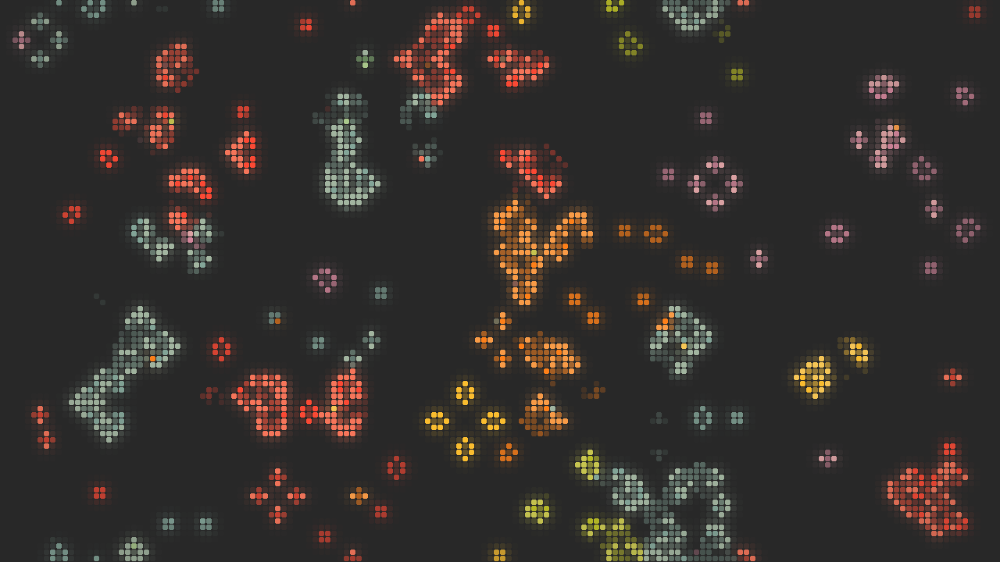

# Conway's Game Of Life Wallpaper

## Installation

### Automatic user install (recommended)

Requirements: a Rust toolchain (`cargo`) and a Wayland compositor that supports `zwlr_layer_shell_v1`.
From the project directory, run:

```sh
./install.sh
```

The script builds the optimized binary and installs it to `~/.local/bin`, the man page to `~/.local/share/man/man1`, and example TOML files to `~/.local/share/life-wallpaper/config_example`. It creates `~/.config/life-wallpaper/config.toml` from the default template only if that file does not already exist, so existing settings are preserved.

If `life-wallpaper` is not found after installation, ensure `~/.local/bin` is on your `PATH`:

```sh
export PATH="$HOME/.local/bin:$PATH"
```

To use the installed manual page:

```sh
man life-wallpaper
```

The script supports these environment overrides: `PREFIX` (default `~/.local`), `BIN_DIR`, `DATA_DIR`, `MAN_DIR`, `CONFIG_DIR`, and `CARGO`.

### Manual install

```sh
cargo build --release
mkdir -p "$HOME/.local/bin" "$HOME/.local/share/man/man1" "$HOME/.config/life-wallpaper"
install -m 755 target/release/life-wallpaper "$HOME/.local/bin/life-wallpaper"
install -m 644 man/life-wallpaper.1 "$HOME/.local/share/man/man1/life-wallpaper.1"
install -m 644 config_example/config.default.toml "$HOME/.config/life-wallpaper/config.toml" # only if you don't already have one
```

If you already have a config file, skip the last command to avoid overwriting your settings. To run without installing, use `cargo run --release -- --preset ambient`.

## Usage

```bash
cargo build --release
cargo run
cargo test
```

## Presets

Select a built-in preset from the command line:

```bash
life-wallpaper --preset default
life-wallpaper --preset ambient
life-wallpaper --preset matrix-rain
life-wallpaper --preset neon-brain
life-wallpaper --preset minimal
```

Preset values are loaded first, then an existing config file can override them, and command-line flags take final precedence. If the config file is missing, it is created from the default template, while the selected preset remains active for that first run. Individual flags can override preset values, for example `life-wallpaper --preset neon-brain --fps 6`.

The manual page is in `man/life-wallpaper.1`. View it with `man ./man/life-wallpaper.1`.

## Staleness and resets

The board is never wiped on a timer. When it goes calm (`stagnation_secs`, default 60, with moving or chaotic cells below `calm_pct` of the grid, or the whole board repeating), new life is added on top of what is already there: soup patches in the emptiest areas plus gliders. When still lifes and oscillators pile up and cover `clutter_pct` of the grid (default 8, `0` = never), about half of them are pruned, whole shapes at a time, fading out over a few generations. The board is never wiped. New soup patches are also dripped in over a few generations instead of appearing at once. `soft_reset_secs` still exists as an optional timed full reset and defaults to `0` (off).

If your existing `~/.config/life-wallpaper/config.toml` was created from an older template, it still contains `soft_reset_secs = 300`. Set it to `0` (or delete the line) to stop the timed resets.

## Keeping the board lively

Nothing here wipes the board. Everything either adds life, thins out frozen shapes, or changes the pace.

- **Local calm (`local_calm_secs`, `tile_size`):** the board is cut into tiles. A tile with nothing moving in it for `local_calm_secs` gets a soup patch (sometimes symmetric), a glider aimed through it, or a methuselah (R-pentomino / acorn). One tile at a time, and not while more than 30% of the board is alive.
- **Decay (`decay_after`, `decay_chance`):** cells that have been stuck in a still life or oscillator for `decay_after` generations (counted once the 64-generation history shows it) die with `decay_chance` per generation. Gliders and chaos are never touched.
- **Cosmic rays (`noise_per_sec`):** random single-cell disturbances knock oscillators out of phase.
- **Rule shifts (`rule_shift_secs`, `rule_shift_gens`, `rule_shift_mode`, `rule_shift_stagger`):** every so often the rule becomes `B34/S23`, `B3/S234` or `B3/S2345` for a few generations, then returns. Only on Life / HighLife boards. By default (`rule_shift_mode = "ripple"`) it travels: tiles switch over ring by ring from a random tile, each holding the new rule for `rule_shift_gens` generations, `rule_shift_stagger` generations apart, so it moves across the board as a wave. `"global"` flips the whole board at once (a pulse; the overlay then shows the temporary rule). A board with a single tile falls back to global. Longer holds flood the board, so keep `rule_shift_gens` small.
- **Fast-forward (`fastforward`, `fastforward_speed`):** while the whole board is calm it runs several generations per tick.
- **Colonies (`colonies`, `colony_mutation`, `colony_colors`):** every cell has a colony; a newborn takes the majority colour of its parents, now and then mutating. Each injection brings a fresh colour. Needs `color = "age"`; shading by age still applies.
- **Traffic and guns (`traffic`, `gun_secs`):** convoys of two to four LWSS / MWSS / HWSS enter from one edge; Gosper guns are removed after `gun_secs`.
- **Symmetry (`symmetry_chance`):** injected soups are sometimes mirrored or rotated.
- **Hyprland (`hypr_events`, `hypr_locate`):** listens on Hyprland's event socket. A workspace switch sends gliders across. With `hypr_locate` (default) the wallpaper also asks Hyprland's command socket where windows are: a closed window leaves a symmetric bloom where it was, and a new window gets a ring of soup around its edge (the window itself covers the wallpaper). Only the output the window is on reacts. Geometry is cached from `j/clients` and refreshed shortly after events that can move windows, so a floating window dragged and closed without ever being focused may bloom at its old spot; anything Hyprland cannot place falls back to a random empty spot. With `hypr_locate = false` every event uses a random spot. Does nothing outside Hyprland.
- **Clock stamp (`clock_stamp_secs`):** every ~`clock_stamp_secs` seconds (default 600, 0 = off) a stamp spells the local time as `HH:MM` in the same 5x7 font as the text stamps, and the rules then eat it like any other stamp. Needs `stamps = true`.
- **Audio (`audio`, `audio_sensitivity`, `audio_command`):** off by default. When on, a helper process records the monitor of the default output (whatever is playing) and a small peak meter sends a glider on each beat (two on a hard one), at most about four a second and not while more than 22% of the board is alive. The default helper is PipeWire's `pw-cat` (`pw-cat --record --format s16 --rate 11025 --channels 1 -P {stream.capture.sink=true} -`); any command that writes raw mono s16le at 11025 Hz to stdout works via `audio_command`. Nothing is linked in and nothing runs when `audio = false`. Read at start-up: restart to change it. Raise `audio_sensitivity` if soft music does nothing, lower it if everything counts as a beat.

## Extra look options

- **`breathe`, `breathe_secs`:** the generation rate swells and ebbs by up to +-`breathe` over `breathe_secs`.
- **`glow`:** empty cells next to live ones take a little of their colour (a cell-resolution blur), so halos fade in and out with the cells.
- **`vignette`:** dims cells towards the screen edges.
- **`hue_drift`, `hue_drift_secs`:** the palette hue wanders by up to +-`hue_drift` degrees.
- **`night_dim`, `night_start`, `night_end`:** removes up to `night_dim` of the brightness between those local hours, with a 45 minute ramp at each end.

Saved boards now also store colony colours; older save files still load.

## Smoothness, look and persistence

- **Crossfade (`smooth`, `render_fps`):** the simulation still steps at `fps`, but cells fade between generations at up to `render_fps` frames per second, so births fade in and deaths fade out. Only the cells that change are redrawn, and an idle board draws nothing. `smooth = false` gives the old stepped look.
- **Pause when hidden (`pause_hidden`):** the wallpaper keeps a Wayland frame callback in flight. If the compositor stops answering it (a fullscreen window on top, screen off or locked), simulating and drawing stop until it answers again, then the timers restart. This only kicks in once the compositor has answered a callback before.
- **Cell look (`cell_gap`, `cell_round`):** a gap of 1 px between cells and rounded corners by default. Set `cell_gap = 0` and `cell_round = false` for solid blocks. The gap scales with the output scale.
- **Persistence (`persist`, `save_secs`):** the board of each output is saved to `$XDG_STATE_HOME/life-wallpaper/<output>.board` (default `~/.local/state/life-wallpaper/`) on exit and every `save_secs`, and restored on start. It is skipped if the file is missing or invalid, if the board was empty, or if it was saved under a different rule than the one the config fixes. A changed resolution keeps the overlapping part.

## Configuration hot reload

On first launch, the app creates `~/.config/life-wallpaper/config.toml` from the bundled `config_example/config.default.toml` template (or creates the file selected by `--config`). Parent directories are created as needed. If the config file cannot be created, the app logs a warning and continues with the built-in `Config::default()` values. Those built-in values match the bundled template.

The wallpaper watches the selected config file automatically (by checking its modification time on each tick). Save `~/.config/life-wallpaper/config.toml` or the file passed with `--config` and the running wallpaper applies the changes without restarting. CLI flags continue to override config-file values. `SIGHUP` reload remains supported:

```bash
pkill -HUP life-wallpaper
```

## License

MIT

## Example configurations

The `config_example/` directory includes optional presets you can try:

- `config.default.toml` — balanced default setup; used to create the config on first launch.
- `ambient.toml` — slower, calmer animation with fewer visual elements.
- `matrix-rain.toml` — green palette with code rain and status text.
- `neon-brain.toml` — brighter neon colors using Brian's Brain.
- `minimal.toml` — a clean look without trails, rain, overlays, patterns, or stamps.

To try a preset, copy its settings into `~/.config/life-wallpaper/config.toml` (or the file you selected with `--config`). You can also copy the preset over that file, then edit it as desired. The running wallpaper automatically reloads changes when the file is saved.

# Preview


